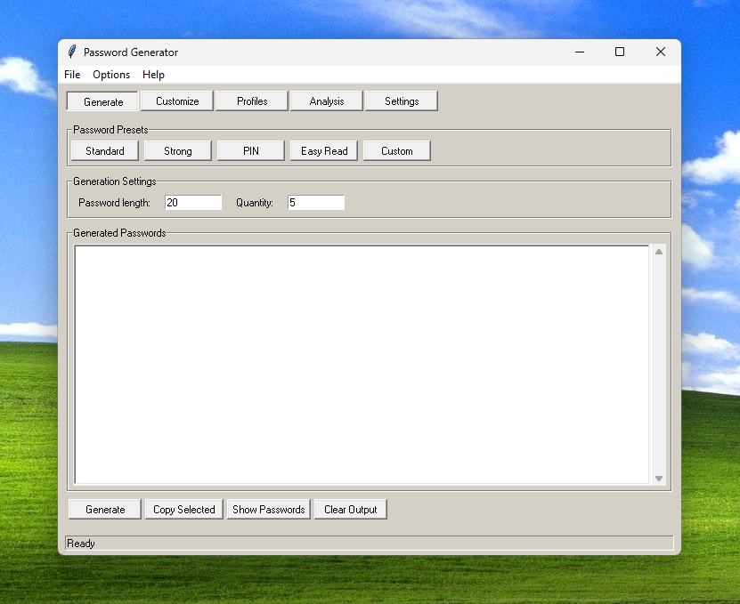

**Version:** v0.01
**Developer:** Franz_Hermann1

A classic Windows-style password generator built with Python and Tkinter.

## Features

- Secure password generation using Python's `secrets` module.
- Customizable password length and quantity.
- Uppercase, lowercase, numbers and symbols.
- Custom character selection.
- Excluded and required characters.
- Password presets.
- Save, load and delete configuration profiles.
- Password strength analysis with theoretical entropy estimates.
- Show and hide generated passwords.
- Copy generated passwords to the clipboard.
- Persistent application settings.
- Classic Windows-style graphical interface.

## Screenshots



## Requirements

- Python 3.14 or a compatible Python version.
- Tkinter (usually included with standard Python installations).

## Run from Source

Clone the repository:

```bash
git clone https://github.com/FranzHermann12/Password-Generator.git
```

Open the project directory:

```bash
cd Password-Generator
```

Run the application:

```bash
python gui.py
```

## Build the Windows Executable

Install PyInstaller:

```bash
python -m pip install pyinstaller
```

Build:

```bash
python -m PyInstaller --onefile --windowed --name PasswordGenerator gui.py
```

The executable will be available inside the `dist` directory.

## Download

Download the Windows executable from the GitHub Releases section.

## Technologies Used

- Python
- Tkinter
- JSON
- PyInstaller

## Security Note

Password strength analysis provides a theoretical estimate based on password length and character pool size. Actual password security may differ.

Never share your generated passwords publicly.

## License

This project is licensed under the MIT License. See `LICENSE` for details.

## Author

**Franz_Hermann1**

GitHub: [https://github.com/FranzHermann12](https://github.com/FranzHermann12)

Website: [https://franzhermann12.github.io/](https://franzhermann12.github.io/)

